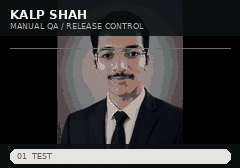
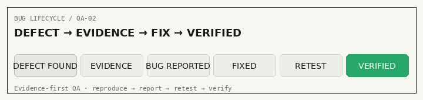

<picture>
  <source media="(max-width: 600px)" srcset="./assets/qa-release-control-mobile.svg">
  <source media="(min-width: 601px)" srcset="./assets/qa-release-control.svg">
  
</picture>

 

<a href="https://kalpshahtester.github.io/"><strong>Portfolio</strong></a> ·
<a href="https://www.linkedin.com/in/kalp-shah-software-tester/"><strong>LinkedIn</strong></a> ·
<a href="https://github.com/kalpshahtester/kalpshahtester.github.io/raw/refs/heads/main/Kalp%20Shah%20Manual%20Tester%20Resume.pdf"><strong>Resume</strong></a> ·
<a href="mailto:manualtesterkalpshah@gmail.com"><strong>Email</strong></a>

  

## Hi, I'm Kalp Shah 👋

**Manual QA Tester | Web Application Testing | WordPress QA**

I help improve website quality by testing real user journeys, identifying defects, documenting clear evidence, and verifying fixes. My approach is practical and user-focused: understand the requirement, explore the application, test expected and edge-case behaviour, and communicate findings so they can be resolved efficiently.

I currently work on website quality assurance, including WordPress websites, UI behaviour, responsive layouts, content accuracy, and regression testing.

## What I Work On

- **Manual testing:** Functional, UI, exploratory, positive/negative, regression, smoke, sanity, and retesting.
- **Web QA:** Navigation, forms, links, user journeys, browser compatibility, and responsive behaviour.
- **WordPress QA:** Page layouts, menus, content, media, forms, plugins, and common website workflows.
- **SEO quality checks:** Page titles, meta descriptions, heading structure, image alt text, and link validation.
- **Defect reporting:** Reproduction steps, expected vs. actual results, severity, priority, screenshots, and retest evidence.
- **Test documentation:** Test scenarios, test cases, test execution, RTM, bug reports, and test summaries.

## Professional Experience

| Role | Organisation | Period |
|---|---|---|
| **Manual QA Tester** | NXS Infotech | May 2026 – Present |
| **Computer Engineer / IT Support** | J. B. And Brothers | June 2020 – January 2025 |

In my current QA role, I work on website testing, defect identification and reporting, evidence capture, issue tracking, and verification of fixes. My previous IT support experience strengthened my troubleshooting, communication, and user-support skills.

## Featured Testing Projects

| Project | Coverage | Documentation / Evidence |
|---|---|---|
| [**SauceDemo – Manual Testing**](https://github.com/kalpshahtester/Manual-Testing-Project-saucedemo-website) | E-commerce workflows from login and product selection through cart and checkout; positive, negative, and regression scenarios. | 47 scenarios · 62+ test cases · 282 execution records |
| [**MakeMyTrip – Testing Assessment**](https://github.com/kalpshahtester/MakeMyTrip-Testing-Assessment) | Travel website workflows, including login, registration, flight and hotel booking, and UI validation. | Manual testing documentation |
| [**QA Portfolio Website**](https://kalpshahtester.github.io/) | Professional profile, testing projects, QA documentation, and resume. | Live portfolio |

*The SauceDemo and MakeMyTrip repositories are practice/assessment projects and are presented as portfolio work, not production client engagements.*

## Tools & Working Environment

| Area | Tools |
|---|---|
| Browser testing | Chrome, Firefox, Microsoft Edge, Chrome DevTools |
| Test & issue management | ClickUp, GitHub |
| Test evidence & reporting | Google Sheets, Microsoft Excel, ShareX |
| Team communication | Slack, Gmail |
| Website quality checks | Lighthouse, browser inspection, SEO validation tools |

## My QA Workflow

  <picture>
    <source media="(max-width: 600px)" srcset="./assets/process/qa-process-mobile.svg">
    <source media="(min-width: 601px)" srcset="./assets/process/qa-process.svg">
    
  </picture>

**Understand requirements → Plan tests → Design test cases → Execute → Report defects → Retest fixes → Run regression → Verify**

A useful defect report should make the issue easy to understand and reproduce. I aim to include the environment, clear steps, test data, expected and actual results, severity/priority, and supporting screenshots or recordings.

## Education & Training

- **Diploma in Information Technology** — Dr. S. & S. S. Ghandhy College of Engineering & Technology
- **Manual Software Testing Training** — TOPS Technologies (April 2025 – September 2025)

## Let's Connect

Open to opportunities in **Manual Software Testing, Web QA, Website Testing, and WordPress QA**.

  

**Quality is built through careful testing, clear evidence, and verified fixes.** 🧪

