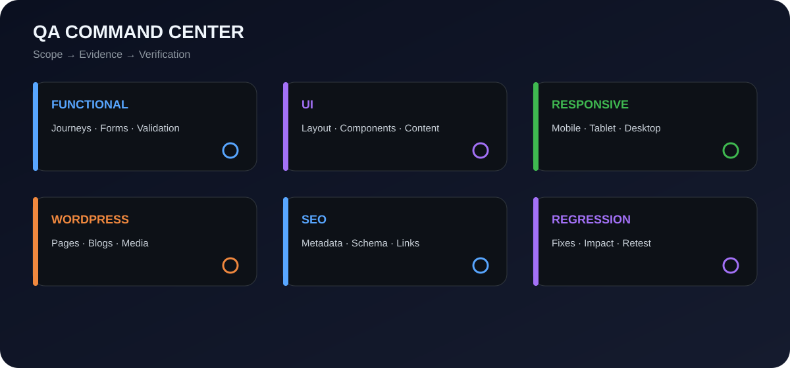
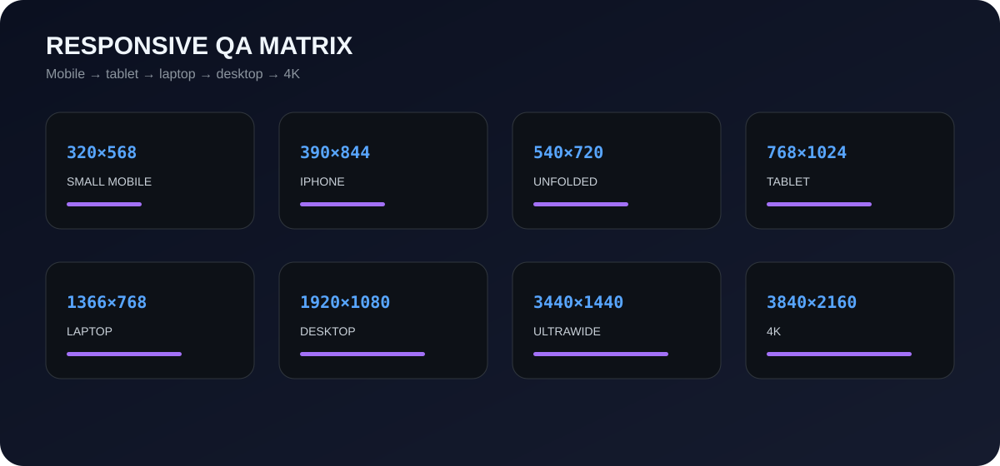
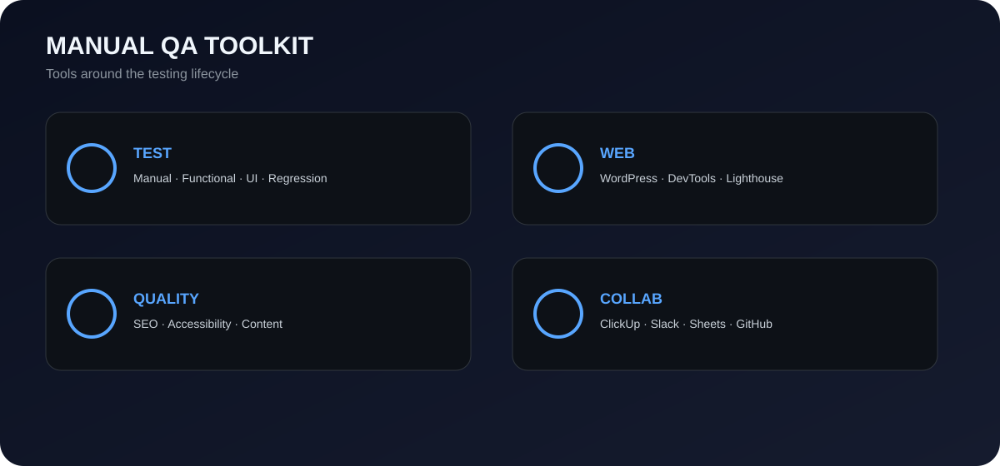
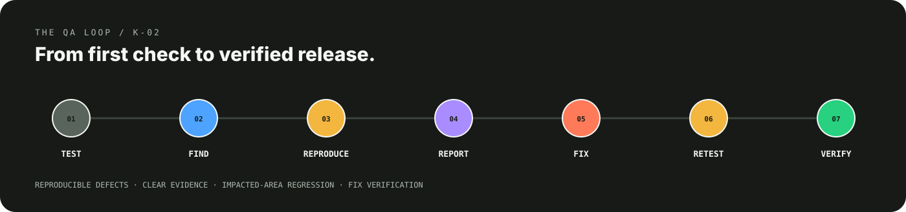

<!--
  Kalp Shah | GitHub Profile README
  Focus: Manual Software Testing, Web QA and WordPress QA
-->

  <picture>
    <source media="(max-width: 600px)" srcset="./assets/qa-release-control-mobile.svg">
    <source media="(min-width: 601px)" srcset="./assets/qa-release-control.svg">
    
  </picture>

  

    <a href="https://kalpshahtester.github.io/"><strong>PORTFOLIO</strong></a>
    &nbsp;·&nbsp;
    <a href="https://www.linkedin.com/in/kalp-shah-software-tester/"><strong>LINKEDIN</strong></a>
    &nbsp;·&nbsp;
    <a href="https://github.com/kalpshahtester/kalpshahtester.github.io/raw/refs/heads/main/Kalp%20Shah%20Manual%20Tester%20Resume.pdf"><strong>RESUME</strong></a>
    &nbsp;·&nbsp;
    <a href="mailto:manualtesterkalpshah@gmail.com"><strong>EMAIL</strong></a>
  

  
  
  

## Kalp Shah
**Manual QA Tester | Web & WordPress Testing**

Manual QA Tester experienced in WordPress and e-commerce website functional testing, responsive/UI checks, bug reproduction and verification, supported by 4+ years of previous IT support experience.

My focus is understanding expected website behaviour, validating real user journeys across screen sizes, finding gaps between expected and actual results, and providing developers with clear, reproducible evidence.

## Manual QA Focus

| Area | Testing coverage |
|---|---|
| **Functional testing** | User journeys, forms, navigation, input validation, positive and negative scenarios |
| **UI and usability testing** | Layout, alignment, content presentation, interactive elements and consistency |
| **Responsive testing** | Mobile, tablet, laptop and desktop layouts and behaviour |
| **WordPress website QA** | Pages, menus, links, media, forms, content and common website components |
| **Basic on-page SEO checks** | Page titles, meta descriptions, heading hierarchy, image alt text and link health |
| **Retesting and regression** | Fixed-defect verification and checks of related areas |
| **Test documentation** | Test scenarios, test cases, execution records, RTM, defect reports and test summaries |

## Professional Experience

### QA Tester — NXS Infotech
**May 2026 – November 2026 | Manual Web & WordPress QA**

- Performed functional and UI checks across WordPress client websites, including navigation, forms, registration/login, product pages, cart, checkout, content and responsive layouts.
- Reviewed basic on-page SEO elements such as page titles, meta descriptions, heading structure and image alt text.
- Captured screenshots and screen recordings using ShareX to provide clear defect evidence.
- Documented issues in Excel and Google Sheets with reproduction steps, expected and actual results, severity, priority and proof links.
- Tracked defects in ClickUp, shared updates with developers through Slack, and retested fixes.
- Performed focused regression checks on related website areas after changes.

### Computer Engineer / IT Support — J. B. And Brothers
**June 2020 – January 2025**

- Supported 100+ employees with software, hardware and network troubleshooting, workstation and application validation, issue documentation and support.
- Investigated hardware and software issues, assisted with troubleshooting, and communicated practical resolutions.
- Built a strong foundation in problem analysis, prioritisation, documentation and user support.

## Selected QA Projects

### [SauceDemo — Manual Testing Project](https://github.com/kalpshahtester/Manual-Testing-Project-saucedemo-website)
A structured manual testing project covering login, product selection, cart operations and checkout workflows.

**Documented project work:** 47 scenarios · 62+ test cases · 282 execution records · 7 documented defects

### [MakeMyTrip — Testing Assessment](https://github.com/kalpshahtester/MakeMyTrip-Testing-Assessment)
A practice assessment covering login, flight search, hotel search, expected and negative conditions, UI checks and structured bug reporting.

### [QA Portfolio Website](https://kalpshahtester.github.io/)
A recruiter-focused portfolio presenting professional experience, manual testing projects, QA documentation and contact information.

  <picture>
    <source media="(max-width: 600px)" srcset="./assets/qa-evidence-mobile.svg">
    
  </picture>

*SauceDemo and MakeMyTrip are portfolio/practice projects. They are not represented as production client engagements. The figures above apply only to the SauceDemo project.*

## Visual QA Coverage

  <picture>
    <source media="(max-width: 600px)" srcset="./assets/qa-command-center-mobile.svg">
    
  </picture>

## Testing Skills

  <picture>
    <source media="(max-width: 600px)" srcset="./assets/responsive-matrix-mobile.svg">
    
  </picture>

Functional, regression, retesting, smoke, sanity, exploratory, UI, responsive, cross-browser, positive/negative testing, boundary value analysis, equivalence partitioning, SDLC, STLC, test scenarios, test cases, RTM and defect lifecycle.

## Tools & Working Knowledge

  <picture>
    <source media="(max-width: 600px)" srcset="./assets/testing-stack-mobile.svg">
    
  </picture>

| Category | Tools |
|---|---|
| **Browsers** | Google Chrome, Mozilla Firefox, Microsoft Edge |
| **Browser inspection** | Chrome DevTools |
| **Test and defect tracking** | ClickUp, GitHub |
| **Evidence capture** | ShareX |
| **Test reporting** | Microsoft Excel, Google Sheets |
| **Team communication** | Slack, Gmail |
| **Website quality checks** | Lighthouse, browser-based SEO and content checks |

## Testing Approach

  

**Understand requirements → Plan coverage → Design test cases → Execute → Capture evidence → Report defects → Retest → Regression → Verify**

I aim to make every defect report actionable: clear steps to reproduce, expected and actual behaviour, supporting evidence, and enough context for a developer to investigate and verify the fix.

## Education & Training

- **Diploma in Information Technology** — Dr. S. & S. S. Ghandhy College of Engineering & Technology
- **[Manual & Automation Tester — TOPS Technologies](https://kalpshahtester.github.io/TOPS_Certificate_Kalp_Shah.pdf)** | Issued 25 March 2026 · [View PDF](https://github.com/kalpshahtester/kalpshahtester.github.io/blob/main/TOPS_Certificate_Kalp_Shah.pdf)
- **[Test Engineer — Product Development, Grade A — Skill India / NSDC](https://kalpshahtester.github.io/NSDC_Certificate_Kalp_Shah.pdf)** | Issued 27 March 2026 · [View PDF](https://github.com/kalpshahtester/kalpshahtester.github.io/blob/main/NSDC_Certificate_Kalp_Shah.pdf)

## Career Interests

Open to opportunities in **Manual Software Testing, Manual QA, Web QA, Website Quality Assurance and WordPress QA**, for **Ahmedabad on-site or remote / work-from-home roles only**.

  
  
  

    
  

  
<strong>Clear evidence. Reliable fixes. Better web experiences.</strong>

