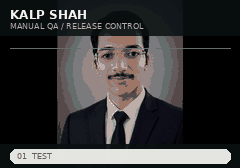
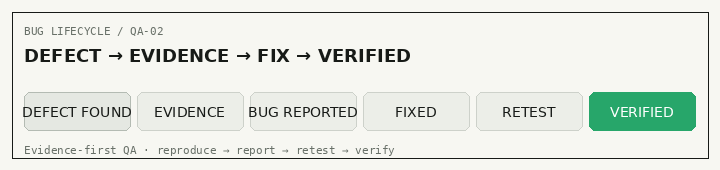

# Kalp Shah | Manual QA Engineer

  <picture>
    <source media="(max-width: 600px)" srcset="./assets/qa-release-control-mobile.svg">
    <source media="(min-width: 601px)" srcset="./assets/qa-release-control.svg">
    
  </picture>

  <a href="https://kalpshahtester.github.io/"><strong>Portfolio</strong></a> ·
  <a href="https://www.linkedin.com/in/kalp-shah-software-tester/"><strong>LinkedIn</strong></a> ·
  <a href="https://github.com/kalpshahtester/kalpshahtester.github.io/raw/refs/heads/main/Kalp%20Shah%20Manual%20Tester%20Resume.pdf"><strong>Resume</strong></a> ·
  <a href="mailto:manualtesterkalpshah@gmail.com"><strong>Email</strong></a>

  
  
  

## About

I am a **Manual QA Engineer** focused on web application quality, WordPress website testing, and reliable release verification. I approach testing from the user's perspective: understand the requirement, explore realistic workflows, identify and reproduce defects, document clear evidence, and verify fixes.

My QA work covers functional behavior, UI consistency, responsive layouts, content and SEO checks, regression testing, and structured test documentation. I focus on practical manual testing that helps teams deliver reliable web experiences.

- **Core focus:** Manual testing, web QA, WordPress QA, defect lifecycle, regression
- **Test documentation:** Test plans, scenarios, test cases, bug reports, RTM, execution summaries
- **Professional links:** [Portfolio](https://kalpshahtester.github.io/) · [LinkedIn](https://www.linkedin.com/in/kalp-shah-software-tester/)

## Featured QA Projects

### 1. SauceDemo — End-to-End Manual Testing

A structured manual testing project covering the e-commerce journey from login through checkout.

| Project evidence | Coverage |
|---|---:|
| Test scenarios | 47 |
| Test cases | 62+ |
| Execution results | 282 |
| Demo user types | 6 |

**Coverage:** Login, product listing, cart, checkout, negative paths, UI checks, exploratory testing, and regression.

- [Project repository](https://github.com/kalpshahtester/Manual-Testing-Project-saucedemo-website)
- [Test cases](https://github.com/kalpshahtester/Manual-Testing-Project-saucedemo-website/tree/main/04_Test_Cases)
- [Bug reports](https://github.com/kalpshahtester/Manual-Testing-Project-saucedemo-website/tree/main/06_Bug_Report)
- [Requirements Traceability Matrix](https://github.com/kalpshahtester/Manual-Testing-Project-saucedemo-website/tree/main/07_RTM)

### 2. MakeMyTrip — Manual Testing Assessment

Testing assessment focused on key travel-booking workflows.

**Coverage:** Login, registration, hotel booking, flight booking, functional validation, negative testing, UI testing, and basic security checks.

[View project and documentation](https://github.com/kalpshahtester/MakeMyTrip-Testing-Assessment)

### 3. WordPress & Website Manual QA

Manual website testing focused on user-facing functionality, content quality, layout consistency, responsive behavior, and release readiness.

**Coverage:** Navigation and links, forms and input validation, UI consistency, responsive layouts, content accuracy, SEO elements, browser compatibility, defect reproduction, and regression verification.

**Typical deliverables:** Test scenarios, test cases, bug reports with screenshots, retest results, and QA summaries.

### 4. Personal QA Portfolio

A GitHub Pages portfolio presenting QA work, documentation, resume, and certifications.

[Visit live portfolio](https://kalpshahtester.github.io/) · [View source repository](https://github.com/kalpshahtester/kalpshahtester.github.io)

## QA Workflow

  <picture>
    <source media="(max-width: 600px)" srcset="./assets/process/qa-process-mobile.svg">
    <source media="(min-width: 601px)" srcset="./assets/process/qa-process.svg">
    
  </picture>

**Understand → Plan → Design tests → Execute → Reproduce → Report → Retest → Regression → Verify**

I aim to make defects actionable by including reproducible steps, test data, expected versus actual results, severity/priority, environment details, and supporting evidence.

## Skills & Tools

| Area | Skills / Tools |
|---|---|
| Manual QA | Functional, UI, exploratory, negative, validation, regression, retesting |
| Web & CMS | Website testing, WordPress QA, responsive testing, cross-browser checks |
| Test artifacts | HLR, test plans, test scenarios, test cases, bug reports, RTM, test summaries |
| QA & collaboration | Chrome DevTools, Lighthouse, GitHub, ClickUp, Slack, Google Sheets, Microsoft Excel |

## Education

**Diploma in Information Technology**  
Dr. S. & S. S. Ghandhy College of Engineering & Technology

## Connect

I am interested in opportunities and collaboration involving **Manual QA, Web Testing, WordPress QA, and software quality assurance**.

  <a href="https://kalpshahtester.github.io/">Portfolio</a> ·
  <a href="https://www.linkedin.com/in/kalp-shah-software-tester/">LinkedIn</a> ·
  <a href="mailto:manualtesterkalpshah@gmail.com">Email</a> ·
  <a href="https://github.com/kalpshahtester">GitHub</a>

