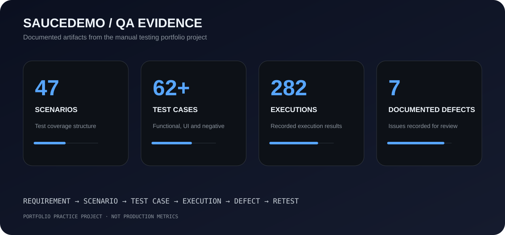

<!--
  Kalp Shah | GitHub Profile README
  Focus: Manual Software Testing, Web QA and WordPress QA
-->

  <picture>
    <source media="(max-width: 600px)" srcset="./assets/qa-release-control-mobile.svg">
    <source media="(min-width: 601px)" srcset="./assets/qa-release-control.svg">
    
  </picture>

  

    <a href="https://kalpshahtester.github.io/"><strong>PORTFOLIO</strong></a>
    &nbsp;·&nbsp;
    <a href="https://www.linkedin.com/in/kalp-shah-software-tester/"><strong>LINKEDIN</strong></a>
    &nbsp;·&nbsp;
    <a href="https://github.com/kalpshahtester/kalpshahtester.github.io/raw/refs/heads/main/Kalp%20Shah%20Manual%20Tester%20Resume.pdf"><strong>RESUME</strong></a>
    &nbsp;·&nbsp;
    <a href="mailto:manualtesterkalpshah@gmail.com"><strong>EMAIL</strong></a>
  

  
  
  

## Kalp Shah
**Manual QA Tester | Website Testing | WordPress QA**

I work on making websites more reliable and easier to use through structured manual testing, clear defect reporting, and careful verification of fixes. My focus is understanding how a website should behave, checking real user journeys across screen sizes, identifying gaps between expected and actual results, and sharing reproducible evidence with developers.

I currently work as a **Manual QA Tester at NXS Infotech**, testing client websites and supporting ongoing website quality improvements. My day-to-day work includes WordPress website testing, UI and functional checks, SEO-related quality reviews, defect documentation, retesting, and regression checks.

## QA Focus

| Area | What I validate |
|---|---|
| **Functional testing** | Core workflows, forms, navigation, input validation, positive and negative scenarios |
| **UI and usability testing** | Layout consistency, alignment, content presentation, interactive elements, and user experience |
| **Responsive testing** | Website behaviour across mobile, tablet, laptop, and desktop viewports |
| **WordPress website QA** | Pages, menus, links, media, forms, content, and common website components |
| **SEO quality checks** | Page titles, meta descriptions, heading hierarchy, image alt text, and link health |
| **Regression and retesting** | Fixed-defect verification, related-area checks, and impact-based regression |
| **Test documentation** | Test scenarios, test cases, execution records, RTM, defect reports, and test summaries |

## Professional Experience

### Manual QA Tester — NXS Infotech
**May 2026 – Present**

- Perform manual quality checks on WordPress-based client websites and web pages.
- Identify functional, UI, responsive, content, and navigation issues through practical test execution.
- Document defects with clear reproduction steps, expected and actual results, severity, priority, and supporting screenshots or recordings.
- Track issues, coordinate findings with developers, and maintain testing updates.
- Retest resolved defects and perform regression checks to confirm that fixes work as expected.
- Review website quality details such as page structure, links, forms, and basic on-page SEO elements.

### Computer Engineer / IT Support — J. B. And Brothers
**June 2020 – January 2025**

- Supported day-to-day computer systems and user-facing technical requirements.
- Investigated technical issues, assisted with troubleshooting, and communicated practical resolutions.
- Developed a foundation in problem analysis, documentation, and user support.

## Selected QA Projects

### [SauceDemo — Manual Testing Project](https://github.com/kalpshahtester/Manual-Testing-Project-saucedemo-website)
A structured manual testing portfolio project covering key e-commerce journeys, including login, product selection, cart operations, and checkout.

**Project documentation:** 47 scenarios · 62+ test cases · 282 execution records

### [MakeMyTrip — Testing Assessment](https://github.com/kalpshahtester/MakeMyTrip-Testing-Assessment)
A practice assessment focused on travel website workflows, including account-related flows, flight and hotel booking journeys, and UI validation.

### [QA Portfolio Website](https://kalpshahtester.github.io/)
A central portfolio for my professional profile, manual testing projects, QA documentation, and resume.

  

*SauceDemo and MakeMyTrip are portfolio/practice projects. They are not represented as production client engagements.*

## Tools & Working Knowledge

| Category | Tools |
|---|---|
| **Browser testing** | Google Chrome, Mozilla Firefox, Microsoft Edge |
| **Browser inspection** | Chrome DevTools |
| **Test and defect tracking** | ClickUp, GitHub |
| **Test evidence** | ShareX |
| **Test reporting** | Microsoft Excel, Google Sheets |
| **Communication** | Slack, Gmail |
| **Website quality checks** | Lighthouse, browser-based SEO and content checks |

## How I Approach Testing

  

**Understand → Plan → Design test cases → Execute → Record evidence → Report defects → Retest → Regression → Verify**

I aim to make every defect report actionable. A good report should help another person understand what failed, reproduce the issue, compare expected and actual behaviour, and verify the correction without guesswork.

## Education & Training

- **Diploma in Information Technology** — Dr. S. & S. S. Ghandhy College of Engineering & Technology
- **Manual Software Testing Training** — TOPS Technologies | April 2025 – September 2025

## Connect

I’m interested in opportunities in **Manual Software Testing, Web QA, Website Quality Assurance, and WordPress QA**.

  
  
  

    
  

  
<strong>Clear evidence. Reliable fixes. Better web experiences.</strong>

